# CloudServe FDE capstone — canonical architecture

This deployable-project copy is synchronized with `Research/11_canonical_architecture.md` in the parent workspace. Update both copies whenever an architecture decision changes.

Status: agreed architecture, 15 November 2026. This is the implementation reference for the two pipelines and six agent roles. The user confirmed successful Azure smoke responses for `gpt-4o`, `o3-mini`, and `text-embedding-ada-002` (1536 embedding dimensions). Component quality, latency, and capstone acceptance targets are still unmeasured.

## End-to-end architecture

```mermaid
flowchart LR
    %% ─────────────── KNOWLEDGE PIPELINE ───────────────
    subgraph KP["A. Governed Knowledge Pipeline — source update par"]
        DOC["29 approved support articles<br/>source_id + version + owner"]
        FORMAT{"Format / extraction clear?"}
        A1["Agent 1: Source Intake<br/>parsing issue assess kare"]
        PARSE["DET: Approved parser<br/>canonical document + lineage"]
        A2["Agent 2: Knowledge Steward<br/>missing steps, duplicates, conflicts"]
        KREVIEW{"BR: Source approved?<br/>Conflict resolved?"}
        KH["HITL: Knowledge owner<br/>certify / reject source"]
        QUAR["DET: Quarantine<br/>reason + audit event"]
        CHUNK["DET: Section-aware chunks<br/>stable passage IDs + permissions"]
        EMB["ML: Azure text-embedding-ada-002<br/>1536-dimensional vectors"]
        INDEX["Published KB<br/>canonical text + dense index<br/>lexical index + index manifest"]

        DOC --> FORMAT
        FORMAT -->|Yes| PARSE
        FORMAT -->|No / ambiguous| A1
        A1 -->|Parser recommendation| PARSE
        A1 -->|Unsafe / unsupported| QUAR
        PARSE --> A2 --> KREVIEW
        KREVIEW -->|Needs approval| KH
        KH -->|Reject / fix| QUAR
        KH -->|Certify| CHUNK
        KREVIEW -->|Already certified and unchanged| CHUNK
        CHUNK --> EMB --> INDEX
    end

    %% ─────────────── TICKET PIPELINE ───────────────
    subgraph TP["B. Ticket Processing — har incoming ticket par"]
        CHANNELS["Email / chat / documentation comments / forum"]
        API["API: POST /v1/tickets<br/>auth + idempotency"]
        NORM["DET: Normalize + persist ticket<br/>ticket_id + trace_id"]
        CLASS["ML: Intent + urgency classifier<br/>calibrated probabilities"]
        PROTECT{"BR: Protected intent?<br/>must_not_auto_respond?"}
        UNCERTAIN{"Decision: ML confidence low<br/>or signals conflicting?"}
        A3["Agent 3: Triage<br/>ambiguous intent / urgency assess kare"]
        ROUTER["DET: Versioned business-rule engine<br/>authorized QueryPlan + reason codes"]
        PATH{"Routing decision"}
        RULEANSWER["DET: Approved rule response<br/>only if exact rule applies"]
        A4["Agent 4: Evidence<br/>query plan + bounded retry"]
        SEARCH["ML/DET tool: Hybrid retrieval<br/>dense + lexical + optional reranker<br/>permission filter before agent prompt"]
        EVIDENCE{"BR: Authorized evidence<br/>sufficient for this question?"}
        A5["Agent 5: Answer<br/>claim-level cited draft"]
        A6["Agent 6: Verification<br/>claim-to-passage review"]
        VALIDATE["DET: Independent validator<br/>schema, exact citation IDs,<br/>source version, PII/secrets,<br/>forbidden claims"]
        PASS{"All release gates pass?"}
        RELEASE["DET: Release gateway<br/>decision log + outbox"]
        SENT["Terminal state: SENT<br/>customer answer + citations"]
        ESC["Terminal state: ESCALATED<br/>reason + context + sources + uncertainty"]
        SH["HITL: Support agent<br/>investigate and resolve"]
        FEEDBACK["Feedback / correction event"]

        CHANNELS --> API --> NORM --> CLASS --> PROTECT
        PROTECT -->|Yes| ESC
        PROTECT -->|No| UNCERTAIN
        UNCERTAIN -->|Yes| A3 --> ROUTER
        UNCERTAIN -->|No| ROUTER
        ROUTER --> PATH
        PATH -->|Protected / unsupported / failure| ESC
        PATH -->|Exact approved rule| RULEANSWER --> VALIDATE
        PATH -->|Approved-document RAG| A4
        A4 --> SEARCH --> EVIDENCE
        EVIDENCE -->|No / tool failure| ESC
        EVIDENCE -->|Yes: EvidenceBundle JSON| A5
        A5 -->|DraftAnswer JSON| A6
        A6 -->|VerificationReport JSON| VALIDATE
        VALIDATE --> PASS
        PASS -->|Yes| RELEASE --> SENT
        PASS -->|No / uncertain| ESC
        ESC --> SH --> FEEDBACK
        SENT --> FEEDBACK
    end

    %% ─────────────── MODEL AND TOOL PLACEMENT ───────────────
    subgraph MODELS["C. Azure OpenAI — models agents ke tools hain"]
        G4["GPT-4o<br/>default bounded agent tasks"]
        O3["o3-mini<br/>conditional complex-case experiment"]
        ADA["text-embedding-ada-002<br/>KB and query embeddings"]
        NLI["Optional claim-support ML/NLI<br/>sirf evaluation ke baad"]
    end

    G4 -.-> A2
    G4 -.-> A4
    G4 -.-> A5
    G4 -.-> A6
    O3 -.-> A3
    O3 -.-> A6
    ADA -.-> EMB
    ADA -.-> SEARCH
    NLI -.-> A6
    INDEX --> SEARCH

    %% ─────────────── API, TRUST AND CLOSED LOOP ───────────────
    subgraph CONTROL["D. APIs, observability and evaluation"]
        HANDOFF["Versioned handoff JSON<br/>event_id + ticket_id/source_id<br/>trace_id + stage + producer"]
        APIS["GET ticket / decision<br/>GET and resolve escalation<br/>POST feedback<br/>POST knowledge job"]
        TRACE["Trace + audit<br/>model, prompt, KB and policy versions<br/>stage latency + cost + failures"]
        GOLD["Human-reviewed gold set<br/>route + relevant passages<br/>required/forbidden claims<br/>claim support + escalation quality"]
        EVAL["Layer-wise evaluation<br/>ML F1/calibration<br/>Retrieval Recall@k<br/>citation support + unsafe-auto rate<br/>p95 latency + terminal reconciliation"]
        IMPROVE["HITL: Approve changes<br/>KB / rules / prompts / models"]
    end

    PARSE -.-> HANDOFF
    A2 -.-> HANDOFF
    NORM -.-> HANDOFF
    CLASS -.-> HANDOFF
    ROUTER -.-> HANDOFF
    A4 -.-> HANDOFF
    A5 -.-> HANDOFF
    A6 -.-> HANDOFF
    RELEASE -.-> HANDOFF
    ESC -.-> HANDOFF
    HANDOFF --> TRACE
    API --> APIS
    SENT --> APIS
    ESC --> APIS
    FEEDBACK --> GOLD --> EVAL --> IMPROVE
    TRACE --> EVAL
    IMPROVE -->|Approved source update| DOC
    IMPROVE -->|Versioned policy update| ROUTER

    classDef agent fill:#dbeafe,stroke:#2563eb,color:#111827
    classDef ml fill:#ede9fe,stroke:#7c3aed,color:#111827
    classDef business fill:#fef3c7,stroke:#d97706,color:#111827
    classDef deterministic fill:#e5e7eb,stroke:#4b5563,color:#111827
    classDef human fill:#dcfce7,stroke:#16a34a,color:#111827
    classDef terminal fill:#fce7f3,stroke:#db2777,color:#111827

    class A1,A2,A3,A4,A5,A6 agent
    class CLASS,EMB,SEARCH,G4,O3,ADA,NLI ml
    class KREVIEW,PROTECT,UNCERTAIN,PATH,EVIDENCE,PASS business
    class PARSE,CHUNK,NORM,ROUTER,RULEANSWER,VALIDATE,RELEASE deterministic
    class KH,SH,IMPROVE human
    class SENT,ESC,QUAR terminal
```

## Implementation invariants

1. Six agents are defined across two pipelines. Source Intake and Triage are conditional; Knowledge Steward runs on source review; Evidence, Answer and Verification run on eligible document-answer paths. A deterministic rule response does not require an LLM draft.
2. Agent outputs are recommendations or drafts. The versioned business-rule engine controls routing; independent validation and the release gateway control customer-facing release.
3. Knowledge publication needs approved source authority. A changed or conflicting source goes to human certification; a certified unchanged version may be republished only under the recorded approval policy.
4. Retrieval filters source permissions before passages enter agent prompts. Every cited passage resolves to the exact approved source and index version.
5. Every accepted ticket reaches exactly one terminal state: `sent` or `escalated`. Human resolution is a later workflow, not a third automated terminal state.
6. The Azure models are connectivity-confirmed by the user. Role fit, latency, cost, classifier calibration, retrieval quality and safety targets still require measurement. `o3-mini` and claim-support NLI remain conditional experiments.
7. Handoff payloads, APIs and metric definitions must be implemented and versioned within this repository. Changes to this diagram must be reflected in contract schemas, API documentation, evaluation definitions and the six-agent workflow.
